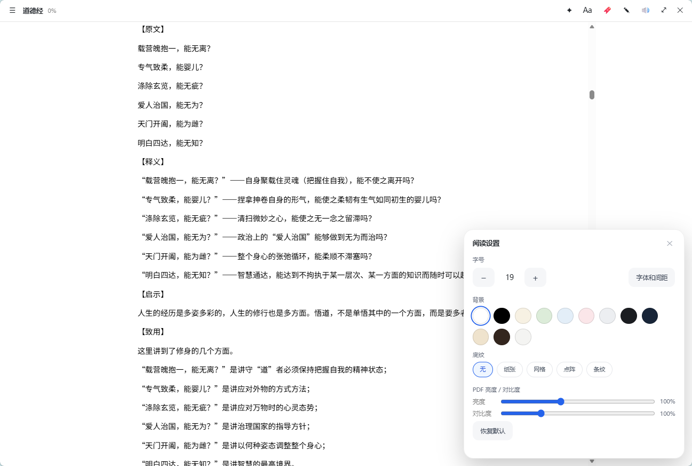
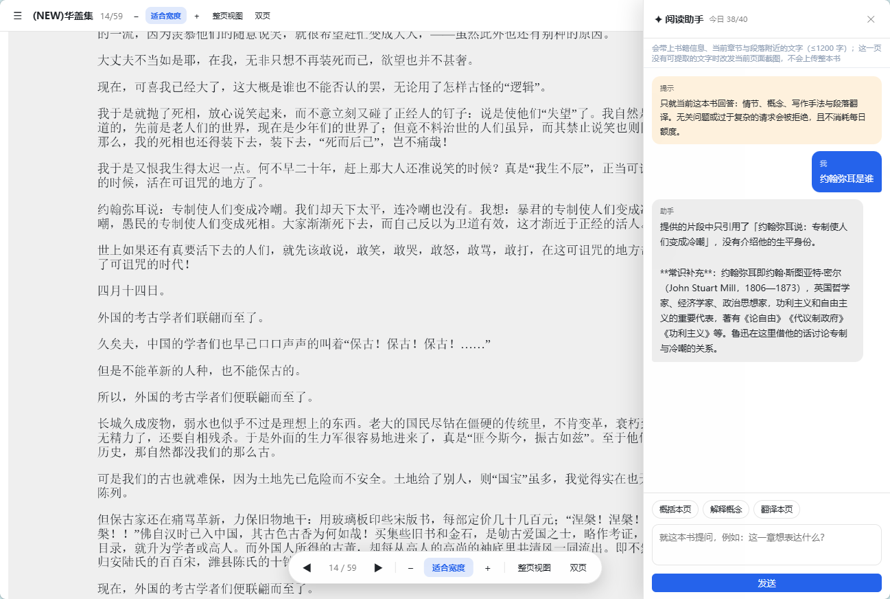

# 飞牛书屋（fnbookshelf）

把 NAS 上的电子书变成一个能搜、能读、能整理的书架。你只需要添加一个目录，它自己扫描、自己刮削、自己出封面；之后在电脑浏览器、手机、电视上都能接着读，每个账号各记各的进度。

**它不接管你的文件，只在你原来的目录上建一层索引。**

- **服务端 / Web**：飞牛 fnOS 原生应用（`.fpk`，不需要 Docker），Express + 原生 JS，无前端构建步骤
- **客户端**：Android 手机版 / TV 版（aapt2 + javac + d8，不依赖 Gradle）
- **系统要求**：fnOS 0.9.0 及以上，x86_64

当前版本 **1.9.10** ｜ [下载安装包](https://github.com/udhorde/fnbookshelf/releases) ｜ [飞牛论坛说明帖](https://club.fnnas.com/forum.php?mod=viewthread&tid=77113)

## 界面

| 书库（全部图书） | 阅读器 |
|---|---|
|  |  |
| **阅读统计** | **管理后台** |
|  |  |

## 四个特色

### 一、一个文件都不挪

这条是设计底线，也是最容易被同类工具破坏的地方。

- 扫描**只读**：不复制、不移动、不改文件名、不写回元数据。封面、缓存、阅读进度、书单全部落在应用自己的数据目录里。
- 同名、同系列多卷（`XX 卷1/卷2/卷3`、`上中下`、`Vol.3`）在书库里自动合并成「一部作品」，**只是索引层面的合并**——磁盘上还是原来那几个文件，位置一个字节没动。
- 想换版本在详情页直接切，打开的还是磁盘上那个文件，不是副本。
- 只有你主动删书，文件才会移进回收站（保留 30 天，可还原）。
- 反过来也成立：在文件管理器里新增、改名、挪目录，回后台点一次扫描就对齐，不会有「导入后再也找不到原文件」的窘境。


### 二、手机 + TV 两个 APP，可在电视上看绘本

不是套壳网页就完事，两端都做了针对性的原生处理。

- **手机 / 平板**：跟随系统旋转、分屏可用；返回键按「网页后退 → 退到底弹设置」逐层走，不会一按就退出；下载交给系统「下载」目录；启动时自检版本，发现新版自动下载并调起安装。
- **TV**：**支持 ppt 格式绘本**，支持一键转成 PDF，强制横屏全屏、无触摸屏声明；遥控器**方向键移动高亮框、确定键点击**，输入框按确定弹原生输入法；网页文字放大到 140%，三米外也看得清。


### 三、AI 助手

后台可添加兼容 OpenAI 的接口实现 AI 助手功能，不配置也能用（找书走本地全库索引）。

- **AI 找书**：用一句描述（「讲中国近代史、偏通俗的」「和《三体》气质接近的科幻」）检索书库并给出理由；不配 AI 时也能本地命中，不耗额度。
- **AI 解读**：书内的章节、段落、文字都可随时提问；1.9.5 起会带上当前书籍信息、所在章节与段落，扫描件/漫画这类提不出文字的页面自动改发**当前页截图**。
- 硬性限制：只发当前页附近约 1200 字，不会上传整本书；单次超 5 秒直接回「我不知道」，不消耗每日额度。

| AI 设置（管理后台） | AI 找书 |
|---|---|
|  |  |




### 四、自动刮削

- 数据来自豆瓣读书，另有 ISBN 直达、当当、**SaltyLeo 的书架**作为补充源：书名、作者、出版社、出版年、ISBN、页数、**封面**、简介。
- 判定顺序是**文件名 → 内嵌元数据 → 目录层级 → 正文抽样**，命中即停，不会为了一本书把整个 PDF 读一遍。
- 刮不到封面时，自动拿 PDF 首页当封面，不留空白格。
- 支持定时调度（每 N 小时 / N 天 / 每周几 / 每月某日，可只刮不扫），刮削失败不影响入库，事后可单本重刮、也可指定关键词重刮。
- 有护栏：相似度不够高时不覆盖你已有的书名，同目录同名的书不会互相串号。

## 功能一览

| 功能 | 说明 |
|---|---|
| 📚 图书管理 | 管理员添加 NAS 本地路径，应用只关联读取，**不搬运、不重命名**任何文件；**定时自动扫描**（1.9.1 起在「扫描与刮削」里自由设定周期：每 N 小时 / 每 N 天 / 每周几 / 每月某日，可顺带自动刮削；分批进行，启动 5 分钟后补扫；若上次是异常退出则跳过补扫，避免重启后又崩）；管理员在书籍详情页能看到**文件的完整存储路径**（点击复制），排查「这到底是哪个文件」不用再进 NAS 翻目录 |
| ⚡ 扫描即入库 | 扫描只做**本地解析**（格式/页数/封面/目录），**不等网络、立即入库可读**；元数据刮削完全交给后台闲时队列，服务空闲时慢慢补全，服务器卡不卡与网速无关 |
| 🔍 多源刮削 | **豆瓣读书 / ISBN 直达 / 当当 / SaltyLeo 的书架** 依次尝试（1.9.0 去掉国家图书馆 OPAC 与读秀——家庭网络下几乎不可达，只会白等超时；Google Books、Open Library 等境外源此前已移除），书名+作者+ISBN 综合评分，低置信不放行；刮不到时**自动抽样前 10 页正文**再刮一次；**打开某本书的详情页会优先补全这一本**（2.5 秒预算），失败源冷却 30 分钟不反复重试 |
| 🧹 无分类 | 不做分类/标签/年份体系，只用搜索与排序；1.9.0 起书库顶部提供**按格式筛选**（EPUB / PDF / TXT…，带数量），点一下只看这类文件 |
| 🧩 版本管理 | **同名书扫描后自动合并**（书名相同即先归到一起；每次自动扫描都会复查并合并一次，刮削拿到新书名后同样会自动合并；刮削拿到可信作者后发现是两本不同书才自动拆开）；**同目录下文件名只差期号/年份的自动聚合成「×× 系列」**（如《人民日报》各期、2013/2014 社论），详情页里各期就是一个个版本；**即使只有一个版本也常显版本栏并列出当前文件**；「编辑」里可**搜索并手动合并其他书籍**、**把某个版本分离成独立书籍**（分离后不再被自动合并）；每行按钮固定为**阅读 → ⬇ 下载 → 申请删除**（可直接下载该版本的原始文件），另有设置默认版本；1.9.0 起可**上下移动调整版本顺序**（第一版就是默认展开的那个），「编辑」里还能**勾选多个搜索结果批量合并**进来。书库顶部「☑ 批量」进入多选模式后用**自绘指针拖拽**（不再用 HTML5 draggable，绝不误触发浏览器搜索页），也可点选两本书合并；**合并/分离不再弹二次确认**，编辑模式下可勾选多个版本批量分离，或一键「全部打散」把整个作品拆成独立书籍 |
| 🌳 按路径合并 | 管理后台「图书库 → 按路径批量合并」按**真实目录结构**列示（和 Windows 资源管理器一样可折叠、可整目录勾选），列的是「一个目录里还散着多部作品」的情况，勾选后只改索引不动文件 |
| 📌 顶栏常驻 | 全部图书与专题列表向下滚动时，**搜索 / AI找书 / 批量 / 改专题**（含格式筛选）始终悬浮在页面顶部；「删专题」属破坏性操作，**仅管理员可见** |
| 🗑 删除审核 | 删除先生成申请；若该版本有用户书签/笔记，**弹窗明确列出是哪些用户**；管理员二次确认后文件移入回收站（不物理销毁）；回收站每条都能**恢复**或**清空**，**进入回收站 30 天后自动删除** |
| 📖 在线阅读 | EPUB（epub.js）、PDF（pdf.js 分块）、MOBI/AZW3/AZW/PRC（foliate-js）、**TXT/MD（编码自动识别 + 分块按需加载，几百 MB 也不卡）**、**Word（.docx / .doc）**、CBZ 漫画、**PPT/PPTX（浏览器内直接逐页渲染，旧版二进制 .ppt 也支持，文字可选、缩放不糊；可一键「存为 PDF」作为新版本入库，同一个文件只转换一次）** |
| 🧭 自动目录 | EPUB nav/NCX、TXT/MD 章节识别、**Word 标题层级（.docx 按 Heading 样式、.doc 按段落格式）**、PPTX 页标题、PDF 内置大纲；侧栏抽屉点击跳转；目录独立缓存文件，不撑大数据库 |
| 🔤 编码无忧 | TXT/MD 按 **BOM → UTF-16 → UTF-8 → GB18030/GBK → Big5** 逐级判定，读前先看内容而不是只看文件名；**历史遗留的乱码书名/作者（UTF-8 被按 Latin-1 解码）会自动还原**，PDF/EPUB 内嵌标题同理；刮削用的书名作者取自**正文前 500 字**，不依赖文件名 |
| 🗂 入库文件类型 | 管理后台「图书库」里可逐项勾选允许入库的后缀（epub/pdf/txt/md/doc/docx/ppt/pptx/cbz/mobi…），也能额外填要排除的后缀；取消勾选后下次扫描直接跳过，NAS 源文件不动，重新勾上即回到书库 |
| 📁 专题 | 侧栏里「🗂 专题」与「📚 全部图书」**平级**（排在它下面，不缩进成子项），点进去是专题总览，像文件夹一样把书按主题归类（如「中国史入门」「待读的科幻」）；管理员点「☑ 选择」可多选，**搜索结果里也能批量建专题**，或批量加入/移出已有专题；专题只记分类关系——文件不移动、书不删除，一本书可以同时在多个专题里，移除专题也不影响书库；1.9.0 起**专题可设置自己的封面**（上传图片，或借用专题里某本书的封面），把书加进专题时**弹窗可一次勾选多个专题**批量加入/移出；书籍详情页新增**专辑管理**，直接看到这本书在哪几个专题里，一键加入/移出/新建 |
| 📱 客户端 | 提供**手机/平板版**与 **TV 版**两个安卓客户端；页面左侧栏底部「📱 下载 APP」进入下载页，管理员在「管理后台 → APP 安装包」上传新包（填版本号即写入），**APP 启动时自检版本，发现新版自动下载并调起系统安装**；APP 内「下载管理」可查看已保存到「下载 / 飞牛书屋」的文件，支持打开、分享、删除 |
| 🔀 二级路径访问 | 除直接访问端口外，还支持在飞牛页面（5667）下用 **/fnbookshelf/** 这样的二级路径登录访问：前端所有资源与接口地址都按当前路径自动加前缀，访问 `/fnbookshelf` 会自动补结尾斜杠，反向代理只转发一个前缀即可 |
| 🔢 页码直达 | 全部图书底部显示「共 N 本」与分页条，可直接输入页码回车跳转，不必一页页点；右侧新增**每页 24 / 48 / 96 / 200 本**下拉，会记住上次选择 |
| 🎚 PDF 画质 | 阅读设置里新增 **PDF 亮度 / 对比度**两个滑杆（只作用于页面图像，不影响界面），老扫描件底色发灰、字发虚时调一下立刻清楚；设置会记住，可一键恢复默认 |
| 🎨 阅读设置 | 字号、字体与行距、**12 色背景**、**5 种底纹**；**PDF 与图片页同样跟随背景色与底纹**（灰度页自动转透明并映射前景色，彩色/插图页原样保留）；**阅读进度自动保存**，下次打开从上次位置继续 |
| 🔍 页面控制 | PDF/图片页工具条：**− / 适合宽度 / ＋**（缩放），**整页视图**（一屏显示整页），**双页**（两页并排）；底部浮动条常显，顶栏同一组按钮便于手机操作 |
| 🔊 TTS 朗读 | 默认浏览器本地语音（离线）；可切换 OpenAI 兼容或 Azure 语音；管理后台**可一键全局关闭**（关闭后阅读器不再显示朗读按钮） |
| 🤖 AI找书 / AI 助手 | 书库右上角按钮已改名 **「✦ AI找书」**，默认走本地全库检索：把整库书名/作者/出版社/丛书/简介/存储目录建成索引，一句自然语言描述（「讲中国近代史、偏通俗的」）直接命中，**不依赖 AI、不耗额度、离线可用**；书库搜索同时匹配**书名 / 作者 / 文件名 / 完整目录路径**（NAS 里按目录整理的书，直接搜目录名就能出来）；搜不到时页面给出**「📣 没找到，通知管理员」**按钮，管理员在后台「📣 找书通知」里能看到大家搜的是什么；配置了 AI 时再让它对前 40 个候选做重排并给理由，AI 超时/不可用自动退回本地结果。AI 助手另有阅读答疑、段落/整页翻译；**超过 5 秒未返回立即中断**，统一回复「我不知道，我是智障」（超时不消耗每日额度）；**硬性禁止上传整本书**——只发送当前页附近 1200 字片段，服务端 64KB 请求体 + 1500 字上下文双重拦截；**1.9.5 起书内提问会附上书籍信息、当前章节与段落位置**，扫描件/漫画/图片页提取不到文字时自动改发**当前页面截图**（只发这一页，≤2.4MB） |
| 🔖 书签 / 高亮 / 笔记 | 选中文字弹出工具条，可高亮、记笔记、AI 解释；侧栏统一管理、点击跳转、导出 Markdown |
| 🔗 外链拦截 | 书内指向外部网站的链接（http/https/mailto/tel）一律拦截，不会跳出阅读器，弹出「已禁止打开外部链接」提示；书内章节跳转不受影响 |
| 🖼 封面设置 | 详情页「设置封面」弹窗四选一：**刮削/内嵌封面**、**书籍文件同目录的图片**（同目录没有图时会自动列出上级目录的候选）、**上传本地图片**（1.9.1 新增，支持 jpg/png/webp/gif/bmp，最大 8MB，可拖拽）、**书内某一页**（PDF / CBZ / 已转换 PPT 可预览指定页）；同目录图选不中时会直接说明原因（格式不支持 / 目录里找不到这张图）；手动封面在重扫与刮削后都不会被覆盖，同一部作品的所有版本同步更新，可一键「恢复自动封面」 |
| 📝 我的记录 | 与全部图书/书架同级的独立模块：全部书签与笔记**按书籍分组**，点击直达详情；封面与详情页版本栏下均显示书签/笔记角标 |
| ⭐ 我的书架 | **登录后默认首页**，上下三栏：①「我的收藏」已在书架的书；②「最近在读」读过但还没收藏的书（带进度条，可一键加入书架）；③「今日为你推荐」每日更换的随机推荐（按日期+用户稳定生成，当天刷新不变） |
| 📊 阅读统计 | 卡片式版面：今日/累计时长、近 7 天柱状图、时长 Top、阅读记录进度条；**新增「✅ 已读完的书籍」栏目**（进度到 100% 自动收录，或详情页点「○ 标为读过」一键加入，可撤销）；管理员可看全体用户统计 |
| 📋 系统日志 | 按天记录、最多保留 **2 天**，**仅保存在本机、不发送任何邮件**；捕获未捕获异常、事件循环阻塞、内存逼近阈值与未正常退出（OOM/断电）；扫描时持续写入进度心跳（阶段 / 最后处理的书 / 内存 RSS），进程被强杀后重启可在后台还原**崩溃现场** |
| 📱 移动端 | ≤760px 抽屉导航 + 自适应栅格；阅读器工具条横向滚动、设置面板贴底全宽 |
| ✈️ 离线优先 | 除「在线刮削」「AI」「云端 TTS」三个可选能力外，阅读、目录、朗读、统计、笔记全部内网离线可用，不依赖任何 CDN |

## 支持的格式

| 格式 | 元数据 | 在线阅读 |
|---|---|---|
| epub | ✅ 完整（含封面/目录） | ✅ 分页、可高亮（CFI 定位） |
| pdf | ✅ | ✅ **Range 分块按需加载**，大文件首屏秒开 |
| mobi / azw3 / azw / prc | ✅ | ✅ 内置 foliate-js 渲染（保留排版/图片/链接） |
| txt / md | 文件名 + 正文首部「书名/作者」 | ✅ **编码自动识别**（UTF-8 / UTF-16 / GB18030 / GBK / Big5）+ **分块按需加载**，自动分章 |
| cbz | ✅ 首图封面 | ✅ 图片翻页 |
| **ppt / pptx** | ✅ | ✅ **浏览器内直接渲染**（内置 `@web-ppt/core`，`.pptx` 与旧版二进制 `.ppt` 都支持）：逐页 SVG、文字可选中、缩放不糊；另可一键「存为 PDF」把当前渲染结果作为本书新版本入库 |
| cbr / djvu / fb2 | 部分 | 下载后本地阅读 |
| **doc / docx** | ✅（.docx 内嵌属性） | ✅ **在线直接阅读**：.docx 解析 OOXML 正文并保留粗体/斜体/标题层级，.doc 走 OLE 片段表（失败时退化为启发式编码扫描）；目录按标题自动生成 |
| rtf / chm / html | 部分 | 下载后本地阅读 |

> **PPT 说明（1.6.3 起默认浏览器直接渲染）**：阅读器把原文件取回浏览器，用随包的 `@web-ppt/core`（MIT / 约 400 KB / 无框架依赖 / 不联网 / 不上传）解析后逐页输出 SVG——文字是真实文字（可选中、可搜索），图片按 data URL 内嵌，缩放不糊，`.pptx` 与 1997–2003 二进制 `.ppt` 共用同一条渲染通道。渲染在浏览器完成，因此不再受 NAS 目录权限、服务端内存或 LibreOffice 缺失影响。1.6.2 的服务端链路（`.pptx` 走 OOXML 抽整页图、`.ppt` 走 OLE `Pictures` 流按 `pib` 对页）**仍保留**为「⚙ 后台转换为 PDF」与「逐页绘制（兼容模式）」兜底；「存为 PDF」则改为浏览器逐页光栅化后交给服务端合成，结果与屏幕所见一致。
> ZIP 类（EPUB/CBZ/PPTX/DOCX）不再整本读入内存：内置轻量 ZIP 读取器只解析中央目录、按需解压所需条目。实测一本 64MB 的 EPUB，读元数据内存占用从 64MB 降到约 1MB；超过 1GB 的极端文件或超大单条目会跳过深度解析。

## 安装步骤

1. 登录飞牛 fnOS → 应用中心 → 本地安装 → 上传 `fnbookshelf_1.9.10_x86.fpk`
2. 安装向导中设置：**访问端口**（默认 8096）、**管理员邮箱**
3. 安装完成后从飞牛桌面点击「飞牛书屋」图标（**在新页面打开**），或浏览器访问 `https://NAS_IP:8096`
4. 首次访问自签名证书浏览器会提示风险，选择「继续访问」即可（也可在后台粘贴正式证书替换）

> 升级安装：直接上传新包，数据与图书索引保留。升级后首次打开请按一次 **Ctrl+F5** 强制刷新。

## 首次登录（重要）

登录页下方会显示 **首次启动配置** 引导，两种方式任选：

**方式 A：在引导页直接配置 SMTP（推荐）**
填入 SMTP 服务器/账号/授权码 → 保存并测试 → 返回上方获取验证码登录。

**方式 B：离线解锁码（邮件不可用时兜底）**
在飞牛文件管理中打开应用数据目录 `…/fnbookshelf/var/data/bootstrap.txt`，把其中的解锁码填到登录页「验证码」框（邮箱填管理员邮箱）。

> 管理员首次登录成功后，引导会永久锁定、解锁码文件自动删除。此后只能在管理后台修改 SMTP。

## 管理员首配清单

1. **邮箱**：后台 → 📧 邮箱 → SMTP（QQ 邮箱推荐 `smtp.qq.com:465` + 授权码）→ 发测试邮件。**SMTP 只用于发送登录验证码，不会发送系统日志**
2. **图书路径**：后台 → 📚 图书库 → 添加 NAS 绝对路径（如 `/vol1/1000/books`）
3. **扫描**：点「立即扫描书库」；「扫描与刮削」里可开启**定时自动扫描**并设定周期（每 N 小时 / N 天 / 每周几 / 每月某日，可顺带自动刮削）。自动扫描按每轮 40 本分批，内存超过保护线会提前收尾并在下轮继续
4. **刮削（可选）**：后台 → 图书库 → 开启在线刮削，勾选刮削源（默认 豆瓣 → ISBN → 当当 → SaltyLeo 的书架；不可达的源会自动冷却 30 分钟）。扫描不依赖刮削，随时可关
5. **TTS（可选）**：后台 → 🔊 语音朗读 → 默认浏览器本地语音即可；也可整体关闭
6. **AI（可选）**：后台 → ✦ AI 设置 → 填接口地址/Key/模型与每日次数后启用
7. **系统日志**：后台 → 📋 系统日志 → 查看崩溃现场（最后处理的书 / 扫描进度 / 内存）、错误记录、自动扫描状态，可立即扫描；日志只存本机，不做邮件外发
8. **删除审核**：后台 → 🗂 删除审核，处理用户提交的删除申请

> ⚠️ 路径权限：应用以 fnOS 分配的专用用户运行（`config/privilege` 只声明 `run-as: package`，不再显式建用户/组，避免与系统已有账号冲突）。运行时目录统一使用框架注入的 `TRIM_PKGVAR` / `TRIM_PKGETC`，安装脚本**不会**在应用根目录强建 `etc/` `var/` 实体目录、也不会对应用目录之外 `chown`/`chmod`。若添加图书路径时提示「不可访问」，请在飞牛 **设置 → 应用 → 授权管理** 中为「飞牛书屋」授予该目录读取权限。

## 阅读器使用说明

- **顶部工具条**：菜单/退出 · 书名进度 · 目录 · 书签 · 笔记 · 朗读 · AI · 设置 · 单页全屏
- **设置面板**：字号 ±、字体和间距（字体族/行高/段距/页宽）、背景 12 色、底纹 5 种
- **AI 面板**：概括本页、解释概念、翻译本页；仅发送当前页片段，不会上传整本书
- **PDF / 图片页底部条**：上一页/页码/下一页 · **− / 适合宽度 / ＋** · **整页视图**（一屏一页）· **双页**（两页并排）；缩放比例单独显示在按钮之间
- **选中文字**：弹出「高亮 / 笔记 / AI 解释 / 翻译」工具条
- **朗读**：点 🔊 开始，底部浮动条可暂停/继续、调 0.5–2.5 倍速、切换引擎与音色
- **快捷键**：`←/→` 翻页，`B` 加书签，`P` 朗读，`F` 单页全屏，`Esc` 退出

## 数据存放位置

```
/var/apps/fnbookshelf/
├── target/        # 程序文件（内嵌 node 运行时 + 服务 + 前端）
├── var/data/      # data.json、covers/、toc/、cache/、trash/、证书
│   └── logs/      # 运行日志（按天 .log，最多 2 天）、crash.json、running.json（崩溃现场）
├── etc/config.env # 端口与管理员邮箱
├── etc/data_dir   # （可选）迁移后的数据目录路径
└── var/app.log    # 进程输出日志
```

如需把数据放到别的存储卷，在后台「💾 数据位置」查看当前路径，或把 `var/data` 迁到目标盘并在 `etc/data_dir` 写入绝对路径后重启应用。

## 目录结构

```
fnbookshelf/                 fnOS 应用（.fpk）
├── manifest                 应用元信息（fnOS 按「键=值」逐行解析，每行只能有一个 =）
├── build.sh                 打包：内嵌 Node 运行时 + server/ + www/ → fnbookshelf_<ver>_x86.fpk
├── appsrc/
│   ├── server/              服务端
│   │   ├── app.js           HTTP 入口、路由挂载、BASE_PATH 二级路径
│   │   ├── routes/          API 路由
│   │   └── lib/             store / scanner / taxonomy / scheduler / booksearch …
│   └── www/                 前端（原生 JS，无打包）
│       ├── js/app.js        书库、详情、筛选、专题、版本管理
│       ├── js/reader.js     阅读器（EPUB / PDF / MOBI / TXT / DOCX / PPT）
│       └── vendor/          epub.js / pdf.js / foliate / webppt
├── cmd/  config/  ui/  wizard/   fnOS 应用生命周期脚本与桌面入口

android/                     Android 客户端
├── build.sh                 aapt2 + javac + d8 + apksigner
├── AndroidManifest-phone.xml / -tv.xml
├── src/core|phone|tv/       Java 源码
├── assets-common/           fnb-common.js（下载交给原生）
└── assets-tv/               tv-nav.js（遥控器空间导航）

docs/screenshots/            README 里的界面截图（公开仓用，已隐去个人路径）
mkepub.js / mkpdf.js / mkppt.js   造测试样本的脚本（见「开发者工具」）
testlib/                     脚本生成的样本文件（gitignore，不入库）
```

## 技术架构

- 后端：Node.js 22（打包内置）+ Express，依赖仅 express / nodemailer / fast-xml-parser（ZIP 解析改为内置 `zipread.js`，不再整本载入）；数据为 JSON 文件（原子写入）
- 前端：原生 SPA + epub.js + pdf.js + foliate-js(mobi)，全部本地化
- 刮削：Node 原生 http(s)（自动识别 GBK/GB2312），豆瓣读书 / ISBN 直达 / 当当 / SaltyLeo 的书架多源评分，`scrapeworker.js` 后台空闲队列 + 详情页优先补全，`limits.js` 控制重任务并发
- PPT 转 PDF：`slideconvert.js` 后台队列（并发 1）→ 优先借用系统已有的 LibreOffice，否则 `slideimages.js` 从 PPTX 包逐页抽取整页图 → `pdfwrite.js` 流式合成 PDF → 作为新版本入库；阅读器的浏览器 Canvas 逐页栅格化保留为兼容模式
- 文本与 Word：`textdoc.js` 统一入口（编码判定 + 256KB 检查点索引 + 区间读取），`worddoc.js` 解析 .docx（`zipread.js` 读 OOXML）与 .doc（`cfb.js` 读 OLE 片段表），`mojibake.js` 负责乱码自愈
- 归并：`taxonomy.js` 产出 workKey / seriesKey / authorKey（同名只看书名，占位作者不算可信），`grouping.js` 在每次扫描后做幂等重排，手动操作以 `groupLocked` 优先
- AI：OpenAI 兼容 chat/completions；前置本地守卫（话题分类、长度/多问题检测、每日配额）与内容体积硬限制，拒绝不消耗额度；`withDeadline` 硬 5 秒超时，超时回复固定文案且不扣额度
- 日志：`logger.js` 批量异步追加按天日志 + 崩溃取证，`scheduler.js` 本地 0 点扫描，`safeio.js` 大文件护栏
- 安全：HMAC 令牌（24 小时，可吊销 / 可全设备失效）、验证码 10 分钟过期、重发限频、防路径穿越、管理接口双重鉴权；查询串令牌仅限只读资源，`/api/*` 一律 `Cache-Control: no-store`

## 构建

**服务端 / fpk**（需 Node 22 与 fnOS 打包环境变量，见 `build.sh` 头部）：

```bash
cd fnbookshelf && bash build.sh
# → fnbookshelf_<ver>_x86.fpk
```

**Android**（需 `android/tools/` 下的 JDK17 + build-tools;34 + platforms;android-34，见 `android/README.md`）：

```bash
cd android && bash build.sh
# → out/fnbookshelf-android-{phone,tv}-<ver>.apk
```

签名密钥放在 `android/keystore/fnb.jks`（**不入库**）。首次构建若缺失，`build.sh` 会自动生成一把自签名密钥——但这意味着**升级覆盖安装会因签名不同而失败**，请自行备份并在多台机器之间复用同一把。

## 开发者工具

根目录下三个脚本用来**造测试样本**，与运行、打包都无关，只在本地手工验证阅读器时需要：

| 脚本 | 产物 | 验证什么 |
|---|---|---|
| `mkepub.js` | `testlib/三体-刘慈欣.epub` | 结构完整（含 `toc.ncx`）的 EPUB，验证目录、分页与 CFI 定位 |
| `mkpdf.js` | `testlib/大文件测试-500页.pdf` | 500 页长文本、未压缩，验证 Range 分块加载与渲染性能 |
| `mkppt.js` | `testlib/产品发布会-theme.ppt` | 模拟 OLE 复合文档的旧版二进制 `.ppt`，验证 PPT 解析与转 PDF |

```bash
node mkepub.js && node mkpdf.js && node mkppt.js   # 产物落在 testlib/（已 gitignore）
```

三者都**不依赖第三方库**（EPUB 那个自带一个最小 ZIP 写入器），生成的大体积样本不入库。

## 本地调试

```bash
PORT=8096 DATA_DIR=/path/to/data ADMIN_EMAIL=you@example.com   node fnbookshelf/appsrc/server/app.js
```

默认启用自签名 HTTPS，`curl` 需加 `-k`。首次启动会自动创建管理员账号，数据全部落在 `DATA_DIR` 下（`data.json` + `secret.key` + `logs/`）。

## 版本

| 版本 | 主要改动 |
|---|---|
| 1.9.10 | 新增刮削源「SaltyLeo 的书架」（含 ISBN 直查）；只有 ISBN 没有书名时也能刮 |
| 1.9.9 | **桌面图标终于会出现了**：入口改到应用目标目录 `target/ui`（安装包根目录那份会被系统丢弃） |
| 1.9.8 | 桌面入口端口不再写 `${wizard_port}` 变量，改为具体数字 |
| 1.9.7 | 端口被占时自动顺延到空闲端口；启动时回写桌面入口 |
| 1.9.6 | 关掉系统端口预检（`checkport=false`）；报「端口占用」时点名占用进程 |
| 1.9.5 | AI 书内提问带上书籍/章节/段落；取不到文字时改发当前页截图 |
| 1.9.4 | 改端口可靠写回 `config.env`（幂等重写，不再丢行/受 CRLF 影响） |
| 1.9.3 | 阅读器退出卡死；PDF/PPT 每页底部灰底空白；多文件一次合并 |
| 1.9.2 | 刮削书名不再串号；格式/出版社/作者筛选；APP 返回键回上层；朗读取全文 |
| 1.9.1 | 扫描调度（每 N 小时/天/周/月）；封面上传；回收站 30 天；顶栏吸顶 |
| 1.9.0 | 书库整理大改：按路径批量合并、批量版本；多端安装包管理；专题封面 |
| 1.8.2 | 刮削依据改为文件名优先；专题；批量版本与整组打散；大库流式落盘 |
| 1.8.1 | 先全库索引再让 AI 精选；乱码书名自愈；按目录层级刮削 |
| 1.8.0 | 编码自动识别；大 TXT 分块；Word 在线阅读；同名/系列自动归并 |
| 1.7.x | 安全加固：验证码、接口限流、令牌生命周期、授权粒度、路径泄露、安全响应头 |
| 1.6.x | PPT 改为浏览器内直接渲染；旧版 `.ppt` 取图转换；安装时断链软链接修复 |
| 1.5.0 | 扫描与刮削解耦，扫描即入库，不再等网络 |

完整改动见 [`fnbookshelf/README.md`](fnbookshelf/README.md)。

## 链接

- 项目主页 / 源码：https://github.com/udhorde/fnbookshelf
- 安装包下载：https://github.com/udhorde/fnbookshelf/releases
- 飞牛论坛说明帖：https://club.fnnas.com/forum.php?mod=viewthread&tid=77113
- 问题反馈：优先提 GitHub Issues；回帖请带上 fnOS 版本、CPU 架构、图书目录路径与相关日志

> 声明：个人自用的开源项目，与飞牛官方无关。开发过程中有 AI 助手参与编码与文档整理，功能取舍、验证与发布由作者负责。重要数据请自行保留备份。
